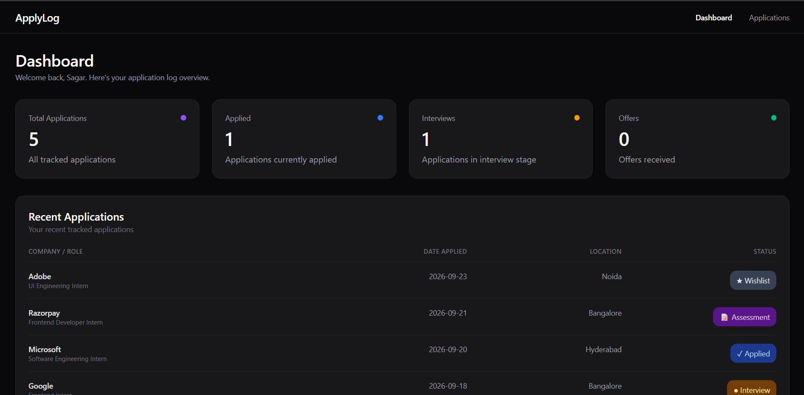
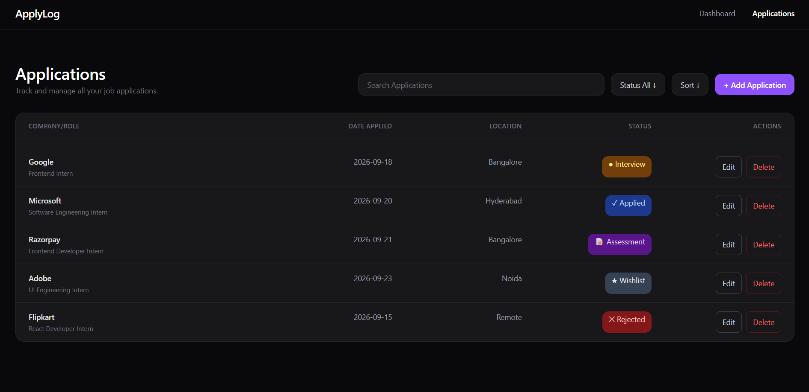

# ApplyLog

A responsive job and internship application tracker built with **React.js** and **Tailwind CSS**.

ApplyLog helps users manage job applications from a single dashboard where they can add, edit, delete, search, filter, and sort applications while tracking important application statuses.

---

## Preview



### Applications



---

## Features

### Dashboard

- Live application statistics
- Total applications count
- Applied applications count
- Interview count
- Offer count
- Recent applications section
- Shows the 5 most recent applications
- Empty state when no applications exist

### Application Management

- Add new applications
- Edit existing applications
- Delete applications
- Delete confirmation modal
- Application status tracking
- Required form validation

### Search, Filter & Sort

- Search applications by company
- Search applications by role
- Filter by application status
- Sort by:
  - Newest
  - Oldest
  - Company A-Z
  - Company Z-A

### User Interface

- Dark SaaS-style interface
- Responsive desktop and mobile layouts
- Responsive navigation
- Responsive application cards on mobile
- Responsive Add/Edit form
- Responsive delete confirmation modal
- Interactive hover states
- Empty states
- Semantic status badges
- Mobile-first responsive design

### Data Persistence

- Applications are stored in browser `localStorage`
- Application data persists after page refresh
- No backend or database is required

---

## Application Statuses

Applications can be tracked using:

- Wishlist
- Applied
- Assessment
- Interview
- Offer
- Rejected

---

## Tech Stack

### Frontend

- React.js
- JavaScript
- Tailwind CSS
- React Router

### Browser APIs

- LocalStorage
- `crypto.randomUUID()`

### Development Tools

- Vite
- Git
- GitHub
- VS Code

---

## Project Structure

```text
src/
├── components/
│   ├── Application.jsx
│   ├── ApplicationForm.jsx
│   ├── ApplicationToolbar.jsx
│   ├── Dashboard.jsx
│   ├── DeleteModule.jsx
│   ├── Navbar.jsx
│   ├── RecentApplications.jsx
│   └── Stats.jsx
│
├── data/
│   └── statusConfig.js
│
├── App.jsx
└── main.jsx
```

---

## What I Practiced

- React components and props
- State management with `useState`
- Side effects with `useEffect`
- Conditional rendering
- CRUD operations
- Search, filtering, and sorting
- Array methods such as `map()`, `filter()`, `sort()`, and `slice()`
- React Router and navigation
- LocalStorage persistence
- Responsive design with Tailwind CSS
- Component-based UI development
- Empty states and modal interactions

---

## Getting Started

```bash
git clone https://github.com/Sagarrr11/job-application-tracker.git
cd job-application-tracker
npm install
npm run dev
```

---

## Future Improvements

- Backend integration
- User authentication
- Cloud database
- Application reminders
- Deployment and production hosting
